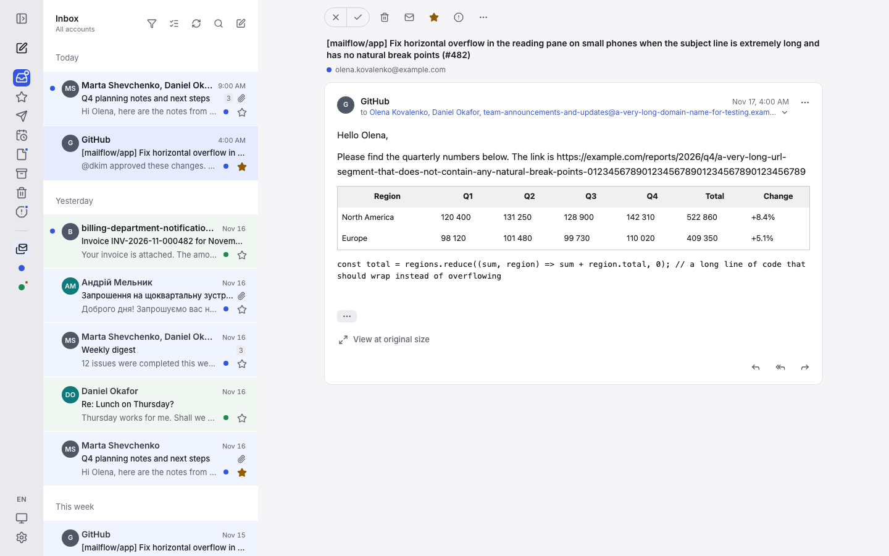
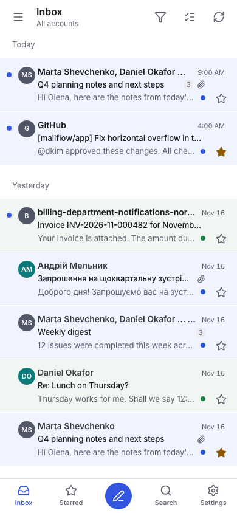
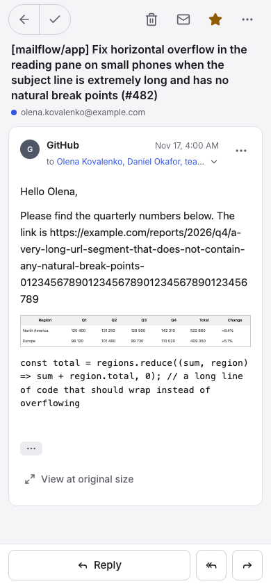
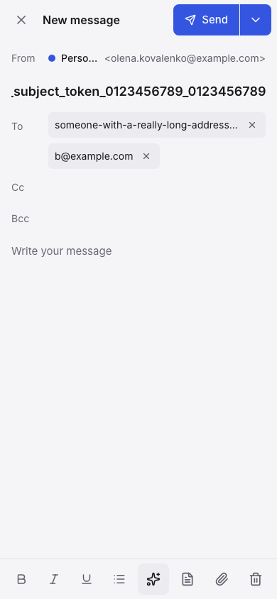
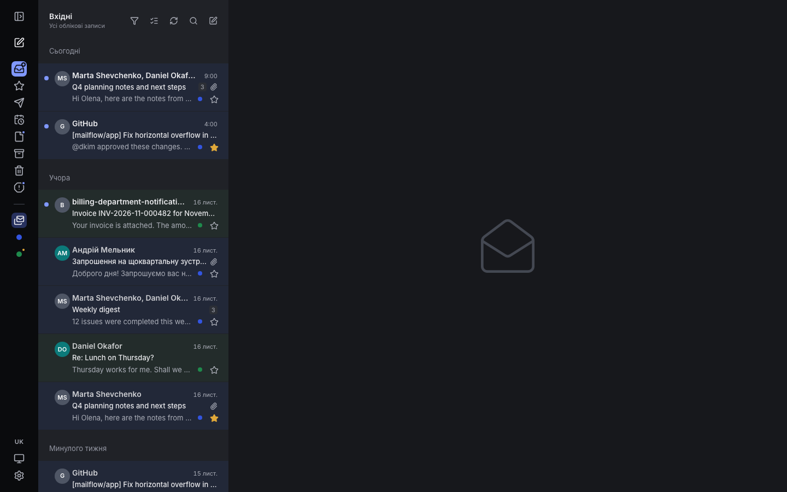
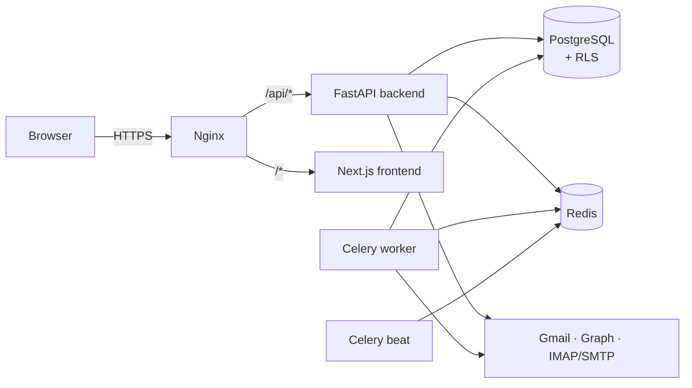

<div align="center">

<picture>
  <source media="(prefers-color-scheme: dark)" srcset="frontend/public/brand/logo-dark.svg">
  
</picture>

### One inbox for all your mailboxes

A multi-tenant SaaS email client. Connect Gmail, Outlook and any IMAP/SMTP account and work with
them in one fast, responsive interface, in English or Ukrainian, light or dark.

[](https://github.com/UkaUkaa/MailFlow/actions/workflows/ci.yml)


**English** · [Українська](README.uk.md)

</div>

---

<p align="center">
  
</p>

<p align="center">
  
  
  
</p>

<p align="center">
  
</p>

<sub>Screenshots come from the Playwright suite, which renders every screen at 21 viewport sizes
from 320 px to 2560 px, in both themes and both languages. The data in them is test data.</sub>

## Contents

- [Features](#features)
- [Engineering highlights](#engineering-highlights)
- [Architecture](#architecture)
- [Tech stack](#tech-stack)
- [Getting started](#getting-started)
- [Testing](#testing)
- [Project structure](#project-structure)
- [Documentation](#documentation)
- [Project status](#project-status)

## Features

**Mail**
- Unified inbox across every connected mailbox, plus per-account views and custom folders
- Conversation threads, a reader with safe HTML rendering, attachments with safe download
- Compose, reply, reply-all and forward; drafts; idempotent sending
- **Send later** and **undo send** on a scheduled outbox
- Bulk actions on up to 100 threads: read/unread, star, archive, trash/restore, spam
- Full-text prefix search over synchronized mail
- Reusable **templates** with placeholders, inserted straight from the composer
- **Write with AI**: draft a reply or a whole email from a short note, using the user's own
  OpenAI, Anthropic or Gemini key. Draft only: the assistant never sends anything

**Accounts**
- Gmail (OAuth 2.0 + PKCE), Outlook / Microsoft 365 (Microsoft Graph), any IMAP/SMTP server
- Background sync: initial import, incremental updates, backfill, recovery after a cursor expires
- Per-account colour and picture so you can tell mailboxes apart at a glance

**Interface**
- Phone, tablet, desktop and ultrawide layouts, each designed for its size
- Light and dark themes, English and Ukrainian with full parity
- Density, preview lines, accent colour, reader text size and other display settings
- Installable as a home-screen web app on iOS and Android

**MailFlow account**
- Registration with email verification, password reset, Sign in with Google
- Session management: see and revoke active sessions
- Account deactivation and full deletion

## Engineering highlights

What the project shows beyond the feature list.

### Multi-tenancy you can trust
- Every user-owned row carries `user_id`. The acting user comes only from the server-side
  session, never from the request body, query string or path.
- Every repository method filters by owner. Someone else's resource returns **404**, never 403,
  so its existence never leaks.
- **PostgreSQL Row-Level Security** as a second layer: the app connects as a restricted role, and
  tenant context is set per transaction with `set_config(..., true)`. A bug in a query still can't
  read another tenant's data.
- Every user-owned resource ships with a cross-tenant test (IDOR, RLS, pooled connections,
  concurrency).

### Security by default
- Argon2id passwords; opaque session tokens stored hashed and sent in `HttpOnly` cookies.
- CSRF double-submit token plus `Origin` check on every state-changing request; rate limiting,
  security headers, trusted hosts.
- **Token Vault**: provider credentials are encrypted with AES-256-GCM, with AAD binding and key
  rotation. They never appear in logs, API responses or Celery arguments.
- All email HTML is untrusted: sanitized on the server, rendered in a sandboxed iframe.
- **SSRF guard** for user-supplied IMAP/SMTP hosts: resolve the name, check every IP, connect to
  the IP that passed the check.

### Clean, enforced architecture
- A modular monolith of 14 backend modules, each split into `domain → application →
  infrastructure / presentation` layers.
- Module boundaries are **checked by architecture tests in CI**, not just written in a document.
- Providers sit behind one adapter contract, so adding a provider doesn't touch the core.
- 45 architecture decisions recorded with their reasoning in [`docs/DECISIONS.md`](docs/DECISIONS.md).

### Background work done right
- Celery tasks carry only IDs. The worker re-reads the account, re-checks ownership and status,
  and fetches credentials from the vault itself.
- Sync uses Gmail history IDs and Microsoft Graph delta links, with Redis locks so two syncs of
  the same mailbox never overlap.

### Responsive as a requirement
- Mobile-first, with `100dvh`, safe-area insets, 44 px touch targets and no hover-only actions.
- No horizontal overflow at any width from 320 px, in either language. Playwright checks this.

### Delivery
- GitHub Actions runs Ruff, MyPy (strict), Pytest against real PostgreSQL / Redis / GreenMail,
  ESLint, TypeScript, Vitest and the Playwright matrix on every pull request.
- A green `main` deploys automatically over SSH and waits for every container to report healthy.
- Hardened containers. Nginx is the only public entry point; PostgreSQL and Redis live on an
  internal network.

## Architecture



Inside each backend module:

```
presentation  ->  application  ->  domain
                      ^
infrastructure -------+   (implements ports declared by application/domain)
```

- **domain**: pure Python. No framework, ORM or SDK imports.
- **application**: use cases and ports (`Protocol`s).
- **infrastructure**: SQLAlchemy models, repositories, provider adapters.
- **presentation**: FastAPI routers and Pydantic schemas. No business logic.

More in [`docs/architecture/OVERVIEW.md`](docs/architecture/OVERVIEW.md).

## Tech stack

| Layer | Technology |
|---|---|
| Backend | Python 3.12, FastAPI, Pydantic v2, SQLAlchemy 2 (async), Alembic, Celery, HTTPX |
| Frontend | Next.js 16 (App Router), React 19, TypeScript (strict), Tailwind CSS 4, Radix / shadcn-style UI |
| Frontend data | TanStack Query, React Hook Form, Zod, next-intl |
| Data | PostgreSQL with Row-Level Security, Redis (broker, cache, locks, rate limits) |
| Infrastructure | Docker Compose, Nginx, GitHub Actions |
| Quality | Ruff, MyPy, Pytest, ESLint, Vitest, Playwright |

## Getting started

### Run the whole stack with Docker

Requirements: Docker with the Compose plugin, and Python 3 (used to generate secrets).

```bash
git clone https://github.com/UkaUkaa/MailFlow.git && cd MailFlow
```

```bash
./scripts/generate-env.sh
```

```bash
docker compose up --build
```

| Service | URL |
|---|---|
| App | <http://localhost:8080> |
| Mail catcher (verification and reset emails) | <http://127.0.0.1:8025> |

Register, open the verification email in the mail catcher and sign in. To connect a real Gmail
or Outlook mailbox, add the OAuth client credentials to `.env` first; see
[`docs/EMAIL_INTEGRATION.md`](docs/EMAIL_INTEGRATION.md). Without them the app still runs and
shows those providers as not configured.

### Local development

Start PostgreSQL, Redis and the mail catcher:

```bash
docker compose -f docker-compose.dev.yml up -d
```

Backend (Python 3.12, [uv](https://docs.astral.sh/uv/)):

```bash
cd backend && uv sync && uv run alembic upgrade head && uv run uvicorn app.main:app --reload
```

Frontend (Node 22+, pnpm):

```bash
cd frontend && pnpm install && pnpm dev
```

The dev frontend proxies `/api` to `http://localhost:8000`. Interactive API docs are at
`/api/docs` (turned off in production).

## Testing

```bash
cd backend && uv run pytest -q && uv run ruff check . && uv run mypy app
```

```bash
cd frontend && pnpm lint && pnpm typecheck && pnpm test && pnpm e2e
```

| Suite | What it covers |
|---|---|
| Backend unit | Domain rules, use cases, provider adapters |
| Backend integration | Real PostgreSQL / Redis, IMAP/SMTP against GreenMail |
| Backend security | IDOR, RLS, cross-tenant access, CSRF, session handling |
| Backend architecture | Module boundaries and layer dependency rules |
| Frontend unit (Vitest) | Components, hooks, form logic |
| Frontend e2e (Playwright) | User flows across the full viewport matrix, both themes and languages |

Details: [`TESTING.md`](TESTING.md) and
[`docs/development/TESTING_STRATEGY.md`](docs/development/TESTING_STRATEGY.md).

## Project structure

```
.
├── backend/
│   ├── app/
│   │   ├── core/                  # config, database, security primitives, middleware
│   │   ├── modules/               # authentication, emails, email_accounts, synchronization,
│   │   │                          # token_vault, search, outbox, templates, assistant, ...
│   │   ├── integrations/          # Gmail, Microsoft Graph, IMAP/SMTP adapters
│   │   └── infrastructure/        # Celery, Redis, mailer wiring
│   ├── migrations/                # Alembic (schema, RLS policies)
│   └── tests/                     # unit, integration, security, architecture
├── frontend/
│   ├── src/modules/               # feature modules: inbox, composer, accounts, settings, ...
│   ├── src/messages/              # en.json, uk.json
│   └── e2e/                       # Playwright specs
├── infra/nginx/                   # the single public entry point
├── docs/                          # architecture, API, security, decisions
└── docker-compose*.yml
```

## Documentation

| Topic | Document |
|---|---|
| Architecture | [`docs/architecture/`](docs/architecture/OVERVIEW.md) |
| API | [`docs/API.md`](docs/API.md) |
| Database | [`docs/DATABASE.md`](docs/DATABASE.md) |
| Security | [`docs/SECURITY.md`](docs/SECURITY.md) |
| Providers and Gmail setup | [`docs/EMAIL_INTEGRATION.md`](docs/EMAIL_INTEGRATION.md) |
| Synchronization | [`docs/EMAIL_SYNC.md`](docs/EMAIL_SYNC.md) |
| Frontend and i18n | [`docs/FRONTEND.md`](docs/FRONTEND.md), [`docs/I18N.md`](docs/I18N.md) |
| Docker, deployment, environment | [`docs/DOCKER.md`](docs/DOCKER.md) |
| Decisions and limitations | [`docs/DECISIONS.md`](docs/DECISIONS.md), [`docs/LIMITATIONS.md`](docs/LIMITATIONS.md) |
| Contributing | [`AGENTS.md`](AGENTS.md), [`docs/development/`](docs/development/DEVELOPMENT_WORKFLOW.md) |

## Project status

MailFlow is an MVP in active development.

| Area | State |
|---|---|
| MailFlow accounts, sessions, security | Done |
| Gmail | Implemented; tested against mocked Gmail API responses |
| Outlook (Microsoft Graph) | Implemented; tested against a mocked Graph API |
| IMAP/SMTP | Implemented; tested against a local GreenMail server |
| Responsive UI, themes, languages | Done |
| End-to-end run with a live Gmail account | Not yet done |

The full list is in
[`IMPLEMENTATION_CHECKLIST.md`](docs/architecture/IMPLEMENTATION_CHECKLIST.md), and known gaps
are in [`LIMITATIONS.md`](docs/LIMITATIONS.md).

---

<div align="center">
<sub>Built by Sasha Filinskyi</sub>
</div>
