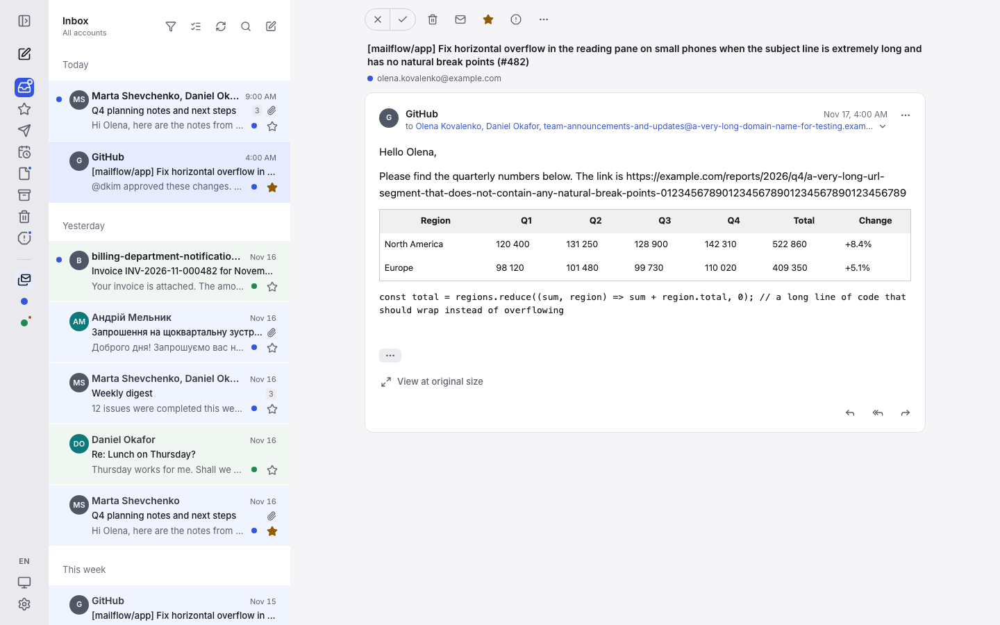
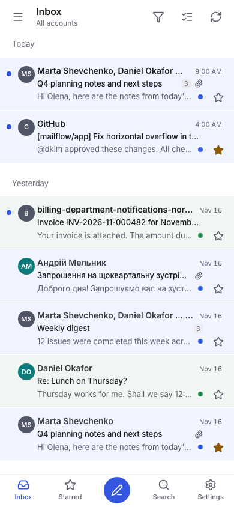
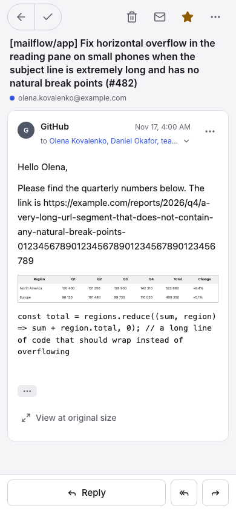
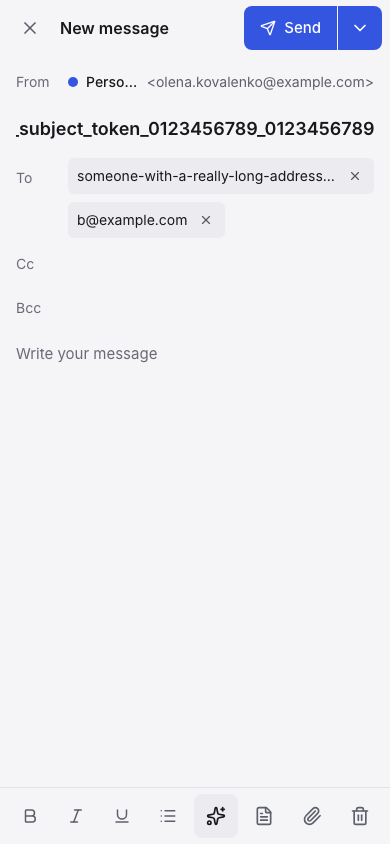
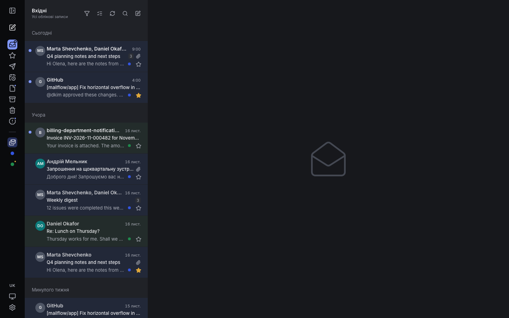
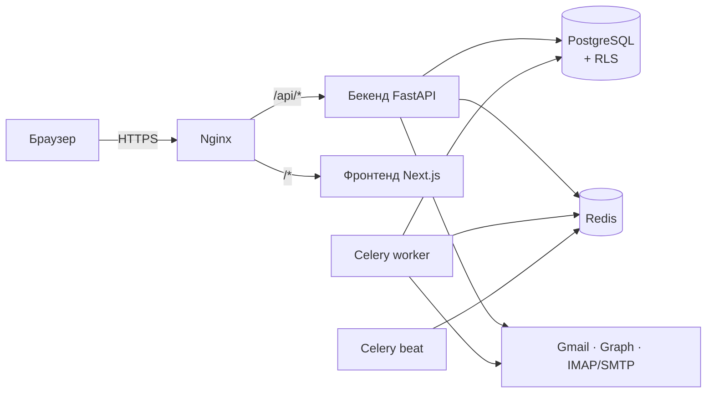

<div align="center">

<picture>
  <source media="(prefers-color-scheme: dark)" srcset="frontend/public/brand/logo-dark.svg">
  
</picture>

### Одна скринька для всіх ваших поштових акаунтів

Мультитенантний SaaS-поштовий клієнт. Під'єднайте Gmail, Outlook і будь-який IMAP/SMTP-акаунт та
працюйте з ними в одному швидкому адаптивному інтерфейсі українською або англійською, у світлій чи
темній темі.

[](https://github.com/UkaUkaa/MailFlow/actions/workflows/ci.yml)


[English](README.md) · **Українська**

</div>

---

<p align="center">
  
</p>

<p align="center">
  
  
  
</p>

<p align="center">
  
</p>

<sub>Скриншоти зроблено тестами Playwright, які відкривають кожен екран у 21 розмірі вікна від
320 до 2560 px, в обох темах і обома мовами. Дані на них тестові.</sub>

## Зміст

- [Можливості](#можливості)
- [Інженерні рішення](#інженерні-рішення)
- [Архітектура](#архітектура)
- [Технології](#технології)
- [Запуск](#запуск)
- [Тестування](#тестування)
- [Структура проєкту](#структура-проєкту)
- [Документація](#документація)
- [Стан проєкту](#стан-проєкту)

## Можливості

**Пошта**
- Спільна скринька для всіх під'єднаних акаунтів, окремі перегляди для кожного акаунта і власні папки
- Ланцюжки листів, безпечне відображення HTML, вкладення з безпечним завантаженням
- Новий лист, відповідь, відповідь усім, пересилання; чернетки; ідемпотентне надсилання
- **Відкладене надсилання** і **скасування надсилання** через чергу вихідних
- Дії з кількома ланцюжками одразу (до 100): прочитано/непрочитано, зірочка, архів, кошик/відновлення, спам
- Повнотекстовий пошук за префіксом по синхронізованій пошті
- **Шаблони** листів із підстановками, які вставляються просто в редактор
- **Написати з AI**: чернетка відповіді або цілого листа з короткої нотатки, з власним ключем
  користувача OpenAI, Anthropic чи Gemini. Тільки чернетка: асистент нічого не надсилає сам

**Поштові акаунти**
- Gmail (OAuth 2.0 + PKCE), Outlook / Microsoft 365 (Microsoft Graph), будь-який IMAP/SMTP-сервер
- Фонова синхронізація: перший імпорт, інкрементні оновлення, догрузка старих листів,
  відновлення після того, як курсор застарів
- Колір і зображення для кожного акаунта, щоб розрізняти скриньки з першого погляду

**Інтерфейс**
- Окремі макети для телефона, планшета, комп'ютера і широкого екрана
- Світла й темна теми; українська та англійська з однаковим покриттям
- Щільність списку, рядки прев'ю, акцентний колір, розмір тексту листа та інші налаштування
- Можна встановити на головний екран як вебзастосунок на iOS та Android

**Акаунт MailFlow**
- Реєстрація з підтвердженням email, скидання пароля, вхід через Google
- Керування сесіями: перегляд і завершення активних сесій
- Деактивація і повне видалення акаунта

## Інженерні рішення

Що показує проєкт, крім переліку функцій.

### Надійна мультитенантність
- Кожен рядок, що належить користувачу, має `user_id`. Поточного користувача визначає лише
  серверна сесія, ніколи не тіло запиту, параметри чи шлях.
- Кожен метод репозиторію фільтрує за власником. Чужий ресурс повертає **404**, а не 403, тож
  навіть сам факт його існування не розкривається.
- **Row-Level Security у PostgreSQL** як другий рівень захисту: застосунок підключається з
  обмеженою роллю, а контекст користувача задається в межах транзакції через
  `set_config(..., true)`. Навіть помилка в запиті не дасть прочитати дані іншого користувача.
- Для кожного ресурсу користувача є тест на доступ з іншого акаунта (IDOR, RLS, пул з'єднань,
  паралельні запити).

### Безпека за замовчуванням
- Паролі в Argon2id; непрозорі токени сесій зберігаються як хеш і передаються в `HttpOnly` cookie.
- CSRF-токен (double-submit) і перевірка `Origin` на кожен запит, що змінює дані; обмеження
  частоти запитів, заголовки безпеки, перелік дозволених хостів.
- **Token Vault**: облікові дані провайдерів зашифровано AES-256-GCM з прив'язкою AAD і ротацією
  ключів. Вони ніколи не потрапляють у логи, відповіді API чи аргументи Celery.
- Весь HTML листів вважається недовіреним: він очищується на сервері й показується в
  ізольованому iframe.
- **Захист від SSRF** для IMAP/SMTP-хостів, які вводить користувач: ім'я резолвиться, кожна
  IP-адреса перевіряється, а з'єднання йде саме на перевірену адресу.

### Чиста архітектура з автоматичною перевіркою
- Модульний моноліт із 14 бекенд-модулів, кожен поділено на шари `domain → application →
  infrastructure / presentation`.
- Межі модулів **перевіряють архітектурні тести в CI**, а не лише документ.
- Провайдери реалізують один спільний контракт адаптера, тож новий провайдер не зачіпає ядро.
- 45 архітектурних рішень записано з обґрунтуванням у [`docs/DECISIONS.md`](docs/DECISIONS.md).

### Правильна фонова робота
- Задачі Celery отримують лише ID. Воркер сам перечитує акаунт, повторно перевіряє власника й
  статус і бере облікові дані з vault.
- Синхронізація використовує history ID у Gmail і delta-посилання в Microsoft Graph, а
  Redis-блокування не дають двом синхронізаціям однієї скриньки йти одночасно.

### Адаптивність як вимога
- Mobile-first, `100dvh`, safe-area відступи, елементи для дотику від 44 px, жодних дій лише при наведенні.
- Жодного горизонтального прокручування сторінки на будь-якій ширині від 320 px, обома мовами.
  Це перевіряє Playwright.

### Доставка
- GitHub Actions на кожен pull request запускає Ruff, MyPy (strict), Pytest на справжніх
  PostgreSQL / Redis / GreenMail, ESLint, TypeScript, Vitest і матрицю Playwright.
- Зелений `main` автоматично розгортається через SSH і чекає, доки кожен контейнер стане healthy.
- Захищені контейнери. Nginx — єдина публічна точка входу; PostgreSQL і Redis працюють у
  внутрішній мережі.

## Архітектура



Усередині кожного бекенд-модуля:

```
presentation  ->  application  ->  domain
                      ^
infrastructure -------+   (реалізує порти, оголошені в application/domain)
```

- **domain**: чистий Python. Без імпортів фреймворків, ORM чи SDK.
- **application**: сценарії використання і порти (`Protocol`).
- **infrastructure**: моделі SQLAlchemy, репозиторії, адаптери провайдерів.
- **presentation**: роутери FastAPI і схеми Pydantic. Без бізнес-логіки.

Детальніше: [`docs/architecture/OVERVIEW.md`](docs/architecture/OVERVIEW.md).

## Технології

| Рівень | Технології |
|---|---|
| Бекенд | Python 3.12, FastAPI, Pydantic v2, SQLAlchemy 2 (async), Alembic, Celery, HTTPX |
| Фронтенд | Next.js 16 (App Router), React 19, TypeScript (strict), Tailwind CSS 4, UI у стилі Radix / shadcn |
| Дані на фронтенді | TanStack Query, React Hook Form, Zod, next-intl |
| Сховища | PostgreSQL з Row-Level Security, Redis (брокер, кеш, блокування, ліміти) |
| Інфраструктура | Docker Compose, Nginx, GitHub Actions |
| Якість | Ruff, MyPy, Pytest, ESLint, Vitest, Playwright |

## Запуск

### Увесь стек у Docker

Потрібні Docker із плагіном Compose і Python 3 (для генерації секретів).

```bash
git clone https://github.com/UkaUkaa/MailFlow.git && cd MailFlow
```

```bash
./scripts/generate-env.sh
```

```bash
docker compose up --build
```

| Сервіс | Адреса |
|---|---|
| Застосунок | <http://localhost:8080> |
| Перехоплювач пошти (листи підтвердження і скидання пароля) | <http://127.0.0.1:8025> |

Зареєструйтеся, відкрийте лист підтвердження в перехоплювачі пошти й увійдіть. Щоб під'єднати
справжню скриньку Gmail чи Outlook, спершу додайте OAuth-ключі в `.env`; див.
[`docs/EMAIL_INTEGRATION.md`](docs/EMAIL_INTEGRATION.md). Без них застосунок працює, а ці
провайдери позначено як неналаштовані.

### Локальна розробка

Запустіть PostgreSQL, Redis і перехоплювач пошти:

```bash
docker compose -f docker-compose.dev.yml up -d
```

Бекенд (Python 3.12, [uv](https://docs.astral.sh/uv/)):

```bash
cd backend && uv sync && uv run alembic upgrade head && uv run uvicorn app.main:app --reload
```

Фронтенд (Node 22+, pnpm):

```bash
cd frontend && pnpm install && pnpm dev
```

Dev-фронтенд проксіює `/api` на `http://localhost:8000`. Інтерактивна документація API — на
`/api/docs` (у продакшені вимкнена).

## Тестування

```bash
cd backend && uv run pytest -q && uv run ruff check . && uv run mypy app
```

```bash
cd frontend && pnpm lint && pnpm typecheck && pnpm test && pnpm e2e
```

| Набір | Що перевіряє |
|---|---|
| Бекенд, unit | Доменні правила, сценарії, адаптери провайдерів |
| Бекенд, інтеграційні | Справжні PostgreSQL / Redis, IMAP/SMTP на GreenMail |
| Бекенд, безпека | IDOR, RLS, доступ з іншого акаунта, CSRF, сесії |
| Бекенд, архітектура | Межі модулів і правила залежностей між шарами |
| Фронтенд, unit (Vitest) | Компоненти, хуки, логіка форм |
| Фронтенд, e2e (Playwright) | Сценарії користувача на всій матриці розмірів, в обох темах і мовах |

Детальніше: [`TESTING.md`](TESTING.md) і
[`docs/development/TESTING_STRATEGY.md`](docs/development/TESTING_STRATEGY.md).

## Структура проєкту

```
.
├── backend/
│   ├── app/
│   │   ├── core/                  # конфігурація, БД, примітиви безпеки, middleware
│   │   ├── modules/               # authentication, emails, email_accounts, synchronization,
│   │   │                          # token_vault, search, outbox, templates, assistant, ...
│   │   ├── integrations/          # адаптери Gmail, Microsoft Graph, IMAP/SMTP
│   │   └── infrastructure/        # Celery, Redis, надсилання листів
│   ├── migrations/                # Alembic (схема, політики RLS)
│   └── tests/                     # unit, integration, security, architecture
├── frontend/
│   ├── src/modules/               # модулі: inbox, composer, accounts, settings, ...
│   ├── src/messages/              # en.json, uk.json
│   └── e2e/                       # сценарії Playwright
├── infra/nginx/                   # єдина публічна точка входу
├── docs/                          # архітектура, API, безпека, рішення
└── docker-compose*.yml
```

## Документація

Документація в репозиторії англійською.

| Тема | Документ |
|---|---|
| Архітектура | [`docs/architecture/`](docs/architecture/OVERVIEW.md) |
| API | [`docs/API.md`](docs/API.md) |
| База даних | [`docs/DATABASE.md`](docs/DATABASE.md) |
| Безпека | [`docs/SECURITY.md`](docs/SECURITY.md) |
| Провайдери і налаштування Gmail | [`docs/EMAIL_INTEGRATION.md`](docs/EMAIL_INTEGRATION.md) |
| Синхронізація | [`docs/EMAIL_SYNC.md`](docs/EMAIL_SYNC.md) |
| Фронтенд і локалізація | [`docs/FRONTEND.md`](docs/FRONTEND.md), [`docs/I18N.md`](docs/I18N.md) |
| Docker, розгортання, змінні середовища | [`docs/DOCKER.md`](docs/DOCKER.md) |
| Рішення та обмеження | [`docs/DECISIONS.md`](docs/DECISIONS.md), [`docs/LIMITATIONS.md`](docs/LIMITATIONS.md) |
| Як долучитися | [`AGENTS.md`](AGENTS.md), [`docs/development/`](docs/development/DEVELOPMENT_WORKFLOW.md) |

## Стан проєкту

MailFlow — MVP в активній розробці.

| Напрям | Стан |
|---|---|
| Акаунти MailFlow, сесії, безпека | Готово |
| Gmail | Реалізовано; перевірено на змоканих відповідях Gmail API |
| Outlook (Microsoft Graph) | Реалізовано; перевірено на змоканому Graph API |
| IMAP/SMTP | Реалізовано; перевірено на локальному сервері GreenMail |
| Адаптивний інтерфейс, теми, мови | Готово |
| Наскрізна перевірка зі справжнім акаунтом Gmail | Ще не зроблено |

Повний перелік — у
[`IMPLEMENTATION_CHECKLIST.md`](docs/architecture/IMPLEMENTATION_CHECKLIST.md), відомі обмеження —
у [`LIMITATIONS.md`](docs/LIMITATIONS.md).

---

<div align="center">
<sub>Автор — Саша Філінський</sub>
</div>
